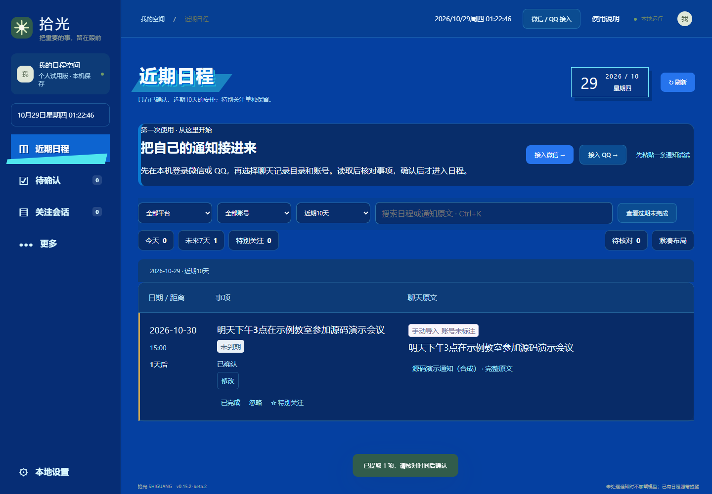

# 拾光 Shiguang

在本机整理微信、QQ 和网页通知，对照原文核对时间，再把确认的安排放进日程。

拾光是一个 Windows 本地日程助手，针对课程群、活动群和通知网页中的时间安排。它先把通知整理成带原文的待确认事项，由用户核对日期和时间后，再加入日程并提醒。

本仓库提供 **0.15.2-beta.2** 的 Windows 核心源码，采用 **[Apache-2.0](LICENSE)**。包含读取、规则提取、核对、提醒、网页订阅和手机同步桥接实现；第三方声明见 [THIRD_PARTY.md](THIRD_PARTY.md)。



上图来自这个源码目录的实际运行，通知文字为合成演示。

[技术架构](docs/architecture.md) · [测试与验证](docs/validation.md) · [开发说明](docs/development.md) · [源码范围](docs/source-scope.md)

## 从通知到提醒

```text
选定的本机聊天 / 粘贴通知 / 文字 PDF / 公开网页
                         ↓
                 本地队列与规则 / 可选模型
                         ↓
                 待确认事项 + 通知原文
                         ↓
                    用户检查、修改
                         ↓
                 SQLite 日程 → Windows 提醒
```

## 技术实现

| 部分 | 实现 | 代码入口 |
| --- | --- | --- |
| 本地服务与存储 | Node.js 24、HTTP API、内置 SQLite | [server.mjs](server.mjs) |
| 通知提取 | 规则初筛、日期范围校验、可选本地模型 | [extract.mjs](extract.mjs)、[time-range.mjs](time-range.mjs)、[model-runtime.mjs](model-runtime.mjs) |
| 微信与 QQ 读取 | 选定账号的只读适配、数据库页校验与增量读取 | [wechat-reader.mjs](wechat-reader.mjs)、[qq-reader.mjs](qq-reader.mjs) |
| 日程与提醒 | 人工核对、持久化投递状态、失败重试、变更后取消旧提醒 | [reminder-delivery.mjs](reminder-delivery.mjs) |
| Windows 窗口 | C#、WebView2、单主窗口与独立后台生命周期 | [DesktopHost.cs](DesktopHost.cs)、[window-sessions.mjs](window-sessions.mjs) |
| 手机桥接 | 配对、AES-GCM 加密、操作幂等和版本冲突处理 | [mobile-bridge.mjs](mobile-bridge.mjs) |
| 前端与回归 | 原生 JavaScript/CSS、node:test、Playwright | [public/](public/)、[test/](test/) |

本项目使用 AI 辅助编码、排错和文档整理。运行结果与测试记录见[验证说明](docs/validation.md)，不以测试通过数量替代真实用户效果或提取准确率。

## 在电脑上运行

准备 Windows 11 x64、Node.js **24.15.0 或更新的 24.x**，在源码目录打开终端：

```powershell
npm ci --ignore-scripts
npm start
```

然后打开 <http://127.0.0.1:43527>。终端中的 Ctrl+C 用于退出。首次启动沿用蓝色主题；桌宠默认关闭，可在本地设置中选用附带的三位原创伙伴。

先点“微信 / QQ 接入”，使用页面里的粘贴通知入口。规则提取不需要模型文件。提取后的事项进入“待确认”，修改或确认后再进入近期日程。

开发数据写入 `.local/data`，使用 43527、43528、43529 三个端口。它和原来个人安装版的数据、端口分开。端口和数据目录都能通过环境变量修改，见 [开发说明](docs/development.md)。

## 能做什么

- 读取选定的本机微信、QQ 账号和会话，显示实际读取与排队进度。
- 粘贴通知，或导入文字 PDF、文本和结构化文件。
- 核对原文、日期、时间，确认、忽略、关注和完成安排。
- 在电脑运行时检查提醒；Windows 原生弹窗和桌面伙伴有对应源码。
- 订阅公开网页，或通过配对与手机客户端同步。
- 按需调用本地 GGUF 模型；没有模型时可先用规则初筛。

微信、QQ 的读取受客户端版本和数据目录影响，重要截止时间仍需人工核对。电脑睡眠、关机或程序彻底退出后，电脑端无法继续读取和提醒。手机端源码不在这次 Windows 核心目录里，相关协议和桥接实现已保留。

## 测试与开发

```powershell
npm test
npm run check:source
```

`npm test` 用合成目录、临时数据库和模拟消息测试解析、持久化、读取及同步逻辑。角色资源和原生窗口测试会按资源、平台和显式开关跳过，测试输出会列出跳过项。

浏览器测试另行安装 Chromium 后运行：

```powershell
npx playwright install chromium
npm run test:ui
```

也可在 Windows 上使用已安装的 Edge：

```powershell
$env:SHIGUANG_BROWSER_CHANNEL = 'msedge'
npm run test:ui
```

原生窗口构建和 Windows 弹窗测试见 [开发说明](docs/development.md)。

## 目录

| 位置 | 内容 |
| --- | --- |
| `server.mjs` 与同层模块 | 本地 HTTP 服务、SQLite、通知解析、读取、提醒和同步 |
| `public/` | 页面、样式、交互和三位原创桌宠图片 |
| `test/` | 合成样例、核心回归及可选平台测试 |
| `scripts/` | 开发启动、测试、源码检查和可选原生窗口构建 |
| `DesktopHost.cs`、`SingleInstance.cs` | Windows WebView2 窗口源码 |
| `docs/`、`licenses/` | 开发说明、源码范围和第三方声明 |

## 数据与素材

私人聊天、账号数据库、登录状态、密钥、录音、字体和壁纸都没有放进这个目录。模型权重、推理引擎和编译后的 EXE/DLL 也不随源码提供。

五条悟、初音未来和 Live2D 模型、SDK 没有打包；相关可选接口仍保留。附带的拾笺、汐白、墨璃是项目原创角色设定，图像由生成工具辅助制作。蓝色主题保留本项目自己的 CSS 和交互实现，不附带游戏素材。

提交问题时请提供复现步骤和版本；不要上传聊天库、密钥或整个 `.local/data`。更多说明见 [贡献说明](CONTRIBUTING.md) 和 [数据说明](docs/privacy.md)。
