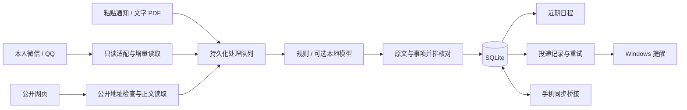

# 技术架构与取舍

拾光从通知中整理安排，保留原文，交给用户确认后再进入日程。实现围绕读取、处理、核对、存储和提醒展开。

图中的移动端只表示 PC 桥接实现；手机 App 源码不在本仓库。

## 本机服务和存储

`server.mjs` 提供绑定到本机的 HTTP 服务，并使用 Node.js 内置 SQLite。原文、事项、操作历史、设置和处理状态保存在开发数据目录。网页前端与 C# WebView2 窗口使用相同服务。

把原文和事项分开保存，是为了能回看提取依据，也让确认、忽略、完成和后续修改保持持久化。已有事项不会因为切换主题或窗口而生成另一套数据。

## 读取和队列

`wechat-reader.mjs`、`qq-reader.mjs` 处理用户选定账号的数据格式。对应平台脚本负责只读检查本机客户端，访问材料通过 DPAPI 保存在本机。适配受客户端版本影响；本仓库不承诺支持所有版本。

`sync-hub.mjs` 管理账号、会话选择、读取状态和进度；`file-import.mjs` 的队列将输入保存后再处理。失败、重试和中断恢复有明确状态，界面的“开始读取”不会直接当作“读取成功”。

## 提取与人工核对

`extract.mjs` 与 `time-range.mjs` 负责规则、日期、时间和范围处理。可选本地模型由 `model-runtime.mjs` 按需启动，空闲后释放；源码包不包含模型权重或推理引擎。

模型结果还需要校验，随后进入待确认页。复杂通知可能有歧义，所以保留原文、允许手动修改，而不是直接替用户做最终决定。

## 提醒可靠性

`reminder-delivery.mjs` 保存投递记录。记录与事项、日期、时间和提前分钟数相关联，投递失败会安排重试；事项取消或时间改变后，旧记录会失效。Windows 弹窗由 `notify.ps1` 实现。

`WindowSessions` 负责窗口注册和退出条件；`SingleInstance.cs` 负责原生主窗口复用。是否关窗后继续提醒取决于后台设置，源码首次启动默认不启用桌宠和托盘。睡眠、关机或后台退出后的电脑提醒不在支持范围内。

## 手机桥接与公开网页

PC 手机桥接实现了配对、AES-GCM 消息封装、重放检查、操作幂等和版本冲突处理。开发入口默认仅监听本机；局域网同步需要用户主动配置和配对。本轮没有重新验证手机真机。

`public-fetch.mjs` 检查协议、目标地址、DNS 结果与重定向，拒绝本机和内网目标，并限制响应大小和超时。这些检查针对公开网页读取，不用于抓取需要登录的私人网页。

## 适合继续改进的方向

目前仍需补充不同微信、QQ 版本和其他电脑的兼容性记录；模型提取也需要独立数据集和明确指标评估。已有自动测试覆盖具体边界，不能据此推导真实通知的总体准确率。
